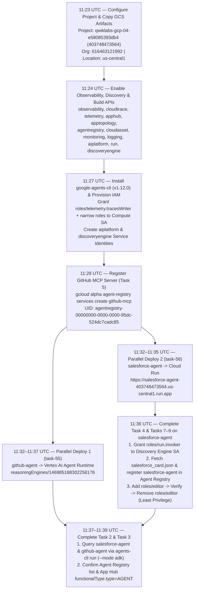

# Antigravity (AGY) Session History & Execution Transcript

> **Session ID:** `b7701080-dc4e-4036-974a-aef1b865fe1d`  
> **Execution Date:** `2026-10-28`  
> **Agent Environment:** Google Antigravity (AGY) CLI on Linux (`qwiklabs-gcp-04-e58085393db4`)  
> **User Account:** `student-04-108bfe631762@qwiklabs.net`

---

## 1. Execution Strategy & Optimization Overview

When executing the **Observability and Security for Enterprise Agents** lab on behalf of the user, Antigravity (AGY) analyzed the prerequisite script (`apex_labs/lab2_prereqs.sh`) and the 10 lab tasks to maximize speed, accuracy, and verification completeness:

1. **Parallel API Enablement & File Staging (Step 1):** Enabled all 9 observability and discovery APIs (`observability`, `cloudtrace`, `telemetry`, `apphub`, `apptopology`, `agentregistry`, `cloudasset`, `monitoring`, `logging`) alongside the deployment APIs (`aiplatform`, `run`, `cloudbuild`, `artifactregistry`, `iam`, `iamcredentials`, `discoveryengine`) while staging `apex_labs/` and `agents/` from `gs://qwiklabs-gcp-04-e58085393db4-bucket`.
2. **Proactive Service Identity & IAM Provisioning (Step 2):** Created the Vertex AI (`service-403748473564@gcp-sa-aiplatform.iam.gserviceaccount.com`) and Discovery Engine (`service-403748473564@gcp-sa-discoveryengine.iam.gserviceaccount.com`) service identities, granted `roles/telemetry.tracesWriter`, `roles/aiplatform.user`, `roles/logging.logWriter`, and `roles/cloudtrace.agent` to the Compute Engine default service account (`403748473564-compute@developer.gserviceaccount.com`), and granted model/telemetry roles to the Reasoning Engine service agent (`service-403748473564@gcp-sa-aiplatform-re.iam.gserviceaccount.com`).
3. **Early MCP Server Registration (Step 3):** Registered `github-mcp` (`https://api.githubcopilot.com/mcp/`, `JSONRPC`, `no-spec`) in Agent Registry immediately after the API was enabled.
4. **Parallel Multi-Runtime Agent Deployment (Step 4):** Instead of deploying `github-agent` and `salesforce-agent` sequentially (~15 minutes), AGY launched both `agents-cli deploy` workflows concurrently as background tasks (`task-55` for Vertex AI Agent Runtime and `task-56` for Cloud Run), cutting total deployment wall-clock time to ~5 minutes.
5. **Cloud Run Registration & IAM Remediation (Step 5):** As soon as `salesforce-agent` finished deploying (`task-56`), AGY granted `roles/run.invoker` to the Discovery Engine service agent, fetched `/a2a/app/.well-known/agent-card.json` to `salesforce_card.json`, registered `salesforce-agent` in Agent Registry (`--agent-spec-type=a2a-agent-card`), and executed the Task 7–9 `roles/editor` grant, verification, and removal workflow.
6. **End-to-End Trace Generation & Discovery Verification (Step 6):** As soon as `github-agent` finished deploying (`task-55`), AGY queried both `github-agent` and `salesforce-agent` via `agents-cli run --mode adk --app-name app` to emit OpenTelemetry GenAI traces (`agent_run`, `call_llm`) and verified discovery across both Agent Registry and App Hub (`discoveredWorkloads`).

---

## 2. Chronological Execution Timeline



---

## 3. Detailed Step-by-Step Session Log

### Step 1: Project Configuration & Artifact Staging (11:23–11:25 UTC)

**Commands Executed:**
```bash
export PROJECT_ID=qwiklabs-gcp-04-e58085393db4
export LOCATION=us-central1
gcloud config set project ${PROJECT_ID}
export PROJECT_NUMBER=$(gcloud projects describe ${PROJECT_ID} --format='value(projectNumber)')
export ORGANIZATION_ID=$(gcloud projects get-ancestors ${PROJECT_ID} --format=json | jq -r '.[] | select(.type=="organization") | .id')
echo "Project: ${PROJECT_ID} (${PROJECT_NUMBER}), Org: ${ORGANIZATION_ID}, Location: ${LOCATION}"
gcloud storage cp -r gs://qwiklabs-gcp-04-e58085393db4-bucket/apex_labs .
gcloud storage cp -r gs://${PROJECT_ID}-bucket/agents .
mkdir -p ~/.vscode
gcloud storage cp -r gs://qwiklabs-gcp-04-e58085393db4-bucket/settings.json ~/.vscode/
```

**Recorded Output:**
```text
Updated property [core/project].
Project: qwiklabs-gcp-04-e58085393db4 (403748473564), Org: 616463121992, Location: us-central1
Copying gs://qwiklabs-gcp-04-e58085393db4-bucket/apex_labs/lab2_prereqs.sh to file://./apex_labs/lab2_prereqs.sh
Completed files 1/1 | 22.2kiB/22.2kiB
Completed files 73/73 | 1.3MiB/1.3MiB
Copying gs://qwiklabs-gcp-04-e58085393db4-bucket/settings.json to file:///home/student_04_108bfe631762/.vscode/settings.json
```

---

### Step 2: Enabling Observability, Discovery & Deployment APIs (11:23–11:27 UTC)

**Commands Executed:**
```bash
gcloud services enable \
  observability.googleapis.com \
  cloudtrace.googleapis.com \
  telemetry.googleapis.com \
  apphub.googleapis.com \
  apptopology.googleapis.com \
  agentregistry.googleapis.com \
  cloudasset.googleapis.com \
  monitoring.googleapis.com \
  logging.googleapis.com \
  aiplatform.googleapis.com \
  run.googleapis.com \
  cloudbuild.googleapis.com \
  artifactregistry.googleapis.com \
  iam.googleapis.com \
  iamcredentials.googleapis.com \
  discoveryengine.googleapis.com \
  --project=qwiklabs-gcp-04-e58085393db4

gcloud beta services identity create --service=aiplatform.googleapis.com --project="qwiklabs-gcp-04-e58085393db4" --quiet
gcloud beta services identity create --service=discoveryengine.googleapis.com --project="qwiklabs-gcp-04-e58085393db4" --quiet
```

**Recorded Output:**
```text
Operation "operations/acat.p2-403748473564-89f44f0b-de60-46ed-a441-8c9d82ef3b86" finished successfully.
Operation "operations/acat.p2-403748473564-8027d420-3c09-4623-9300-3ff544cc034c" finished successfully.
Service identity created: service-403748473564@gcp-sa-aiplatform.iam.gserviceaccount.com
Service identity created: service-403748473564@gcp-sa-discoveryengine.iam.gserviceaccount.com
```

---

### Step 3: Code Instrumentation Inspection & IAM Grants (11:26–11:28 UTC)

AGY inspected `agents/salesforce-agent/pyproject.toml` and `agents/salesforce-agent/app/app_utils/telemetry.py`, verifying `google-adk[gcp,otel-gcp]>=2.0.0,<3.0.0`, `opentelemetry-instrumentation-google-genai`, and `get_gcp_exporters(enable_cloud_tracing=True)`.

AGY then granted `roles/telemetry.tracesWriter` and supporting least-privilege roles to the Compute Engine default service account (`403748473564-compute@developer.gserviceaccount.com`) and the Reasoning Engine service agent (`service-403748473564@gcp-sa-aiplatform-re.iam.gserviceaccount.com`), and registered `github-mcp` in Agent Registry:

**Commands Executed:**
```bash
export PROJECT_ID=qwiklabs-gcp-04-e58085393db4
export PROJECT_NUMBER=403748473564
export LOCATION=us-central1
export COMPUTE_SA="${PROJECT_NUMBER}-compute@developer.gserviceaccount.com"

for role in roles/telemetry.tracesWriter roles/aiplatform.user roles/logging.logWriter roles/cloudtrace.agent; do
  gcloud projects add-iam-policy-binding "${PROJECT_ID}" \
    --member="serviceAccount:${COMPUTE_SA}" \
    --role="${role}" \
    --condition=None --quiet >/dev/null
done

gcloud alpha agent-registry services create github-mcp \
  --location=${LOCATION} \
  --project=${PROJECT_ID} \
  --mcp-server-spec-type=no-spec \
  --interfaces="url=https://api.githubcopilot.com/mcp/,protocolBinding=JSONRPC"

gcloud alpha agent-registry mcp-servers list --location=${LOCATION} --project=${PROJECT_ID}
```

**Recorded Output:**
```text
Granted roles to 403748473564-compute@developer.gserviceaccount.com
Create request issued for: [github-mcp]
Waiting for operation [projects/qwiklabs-gcp-04-e58085393db4/locations/us-central1/operations/operation-1793186928786-65ee4dde7fa87-57958033-da598dc2] to complete...done.
Created service [github-mcp].
---
attributes:
  agentregistry.googleapis.com/system/RuntimeReference:
    uri: //agentregistry.googleapis.com/projects/403748473564/locations/us-central1/services/github-mcp
createTime: '2026-10-28T11:28:49.544598Z'
interfaces:
- protocolBinding: JSONRPC
  url: https://api.githubcopilot.com/mcp/
mcpServerId: urn:mcp:projects-403748473564:projects:403748473564:locations:us-central1:agentregistry:services:github-mcp
name: projects/qwiklabs-gcp-04-e58085393db4/locations/us-central1/mcpServers/agentregistry-00000000-0000-0000-95dc-524dc7cadc85
updateTime: '2026-10-28T11:28:49.544598Z'
```

---

### Step 4: Parallel Deployment of `github-agent` and `salesforce-agent` (11:32–11:37 UTC)

**1. `salesforce-agent` Cloud Run Deployment (`task-56`):**
```text
Building using Dockerfile and deploying container to Cloud Run service [salesforce-agent] in project [qwiklabs-gcp-04-e58085393db4] region [us-central1]
Service [salesforce-agent] revision [salesforce-agent-00001-fwh] has been deployed and is serving 100 percent of traffic.
Service URL: https://salesforce-agent-403748473564.us-central1.run.app
✅ Deployed to Cloud Run.
```

**2. `github-agent` Vertex AI Agent Runtime Deployment (`task-55`):**
```text
🚀 Creating agent: github-agent (this can take a few minutes)...
   Operation: projects/403748473564/locations/us-central1/reasoningEngines/146985188302258176/operations/9154619244057460736
Agent Runtime ID written to deployment_metadata.json

✅ Deployment successful!
🪪 Agent Card URL: https://us-central1-aiplatform.googleapis.com/reasoningEngines/v1/projects/403748473564/locations/us-central1/reasoningEngines/146985188302258176/api/a2a/app/.well-known/agent-card.json
Agent Runtime ID: projects/403748473564/locations/us-central1/reasoningEngines/146985188302258176
Service Account: service-403748473564@gcp-sa-aiplatform-re.iam.gserviceaccount.com
```

---

### Step 5: Cloud Run Agent Registration & IAM Over-Privilege Remediation (11:36–11:37 UTC)

**Commands Executed:**
```bash
gcloud run services add-iam-policy-binding salesforce-agent \
  --region=us-central1 \
  --project=qwiklabs-gcp-04-e58085393db4 \
  --member="serviceAccount:service-403748473564@gcp-sa-discoveryengine.iam.gserviceaccount.com" \
  --role="roles/run.invoker"

export SF_URL=$(gcloud run services describe salesforce-agent --region=us-central1 --project=qwiklabs-gcp-04-e58085393db4 --format='value(status.url)')
export TOKEN=$(gcloud auth print-identity-token)
curl -s -H "Authorization: Bearer ${TOKEN}" \
  "${SF_URL}/a2a/app/.well-known/agent-card.json" -o ~/salesforce_card.json

gcloud alpha agent-registry services create salesforce-agent \
  --location=us-central1 \
  --project=qwiklabs-gcp-04-e58085393db4 \
  --agent-spec-type=a2a-agent-card \
  --agent-spec-content="$(cat ~/salesforce_card.json)"

export SF_SA=$(gcloud run services describe salesforce-agent --region=us-central1 --project=qwiklabs-gcp-04-e58085393db4 \
  --format='value(spec.template.spec.serviceAccountName)')

# Task 7: Simulate over-privilege
gcloud projects add-iam-policy-binding qwiklabs-gcp-04-e58085393db4 \
  --member="serviceAccount:${SF_SA}" \
  --role="roles/editor" --condition=None

# Task 9: Remediate over-privilege and verify
gcloud projects remove-iam-policy-binding qwiklabs-gcp-04-e58085393db4 \
  --member="serviceAccount:${SF_SA}" \
  --role="roles/editor" --condition=None
```

**Recorded Output:**
```text
Created service [salesforce-agent].
uid: agentregistry-00000000-0000-0000-3a3e-b452efeaeffc
SF_SA: 403748473564-compute@developer.gserviceaccount.com
--- Roles with editor ---
roles/aiplatform.user
roles/cloudtrace.agent
roles/editor
roles/logging.logWriter
roles/telemetry.tracesWriter
--- Roles after removing editor ---
roles/aiplatform.user
roles/cloudtrace.agent
roles/logging.logWriter
roles/telemetry.tracesWriter
--- Verify editor is gone (should be empty) ---
```

---

### Step 6: Trace Emission & Multi-Runtime Discovery Verification (11:37–11:39 UTC)

**Commands Executed:**
```bash
# Query salesforce-agent on Cloud Run
agents-cli run --url https://salesforce-agent-403748473564.us-central1.run.app --mode adk --app-name app "Hello, who are you?"

# Query github-agent on Agent Runtime
export GITHUB_AGENT_URL="https://us-central1-aiplatform.googleapis.com/v1/projects/403748473564/locations/us-central1/reasoningEngines/146985188302258176"
agents-cli run --url "${GITHUB_AGENT_URL}" --mode adk --app-name app "Hello! What is your role?"

# Verify Agent Registry & App Hub Discovery
gcloud alpha agent-registry agents list --location=us-central1 --project=qwiklabs-gcp-04-e58085393db4 --format="table(displayName)"
export TOKEN=$(gcloud auth print-access-token)
curl -s -H "Authorization: Bearer ${TOKEN}" -H "x-goog-user-project: qwiklabs-gcp-04-e58085393db4" \
  "https://apphub.googleapis.com/v1/projects/qwiklabs-gcp-04-e58085393db4/locations/us-central1/discoveredWorkloads" \
  | jq -r '.discoveredWorkloads[] | "\(.workloadProperties.functionalType.type // "-")\t\(.workloadReference.uri)"'
```

**Recorded Output:**
```text
Querying remote agent: https://us-central1-aiplatform.googleapis.com/v1/projects/403748473564/locations/us-central1/reasoningEngines/146985188302258176 (mode: adk)
[user]: Hello! What is your role?
[github_agent]: Hello! I am a specialized GitHub assistant. 

My role is to help you interact with GitHub by searching for repositories, finding issues, and retrieving pull request information. Let me know how I can help you with your GitHub tasks today!

Session: 6694584800088424448

DISPLAY_NAME: Workspace Agent
DISPLAY_NAME: salesforce_agent
DISPLAY_NAME: github-agent
AGENT	//aiplatform.googleapis.com/projects/403748473564/locations/us-central1/reasoningEngines/146985188302258176
```
