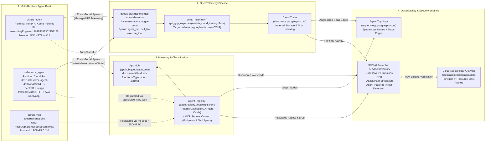
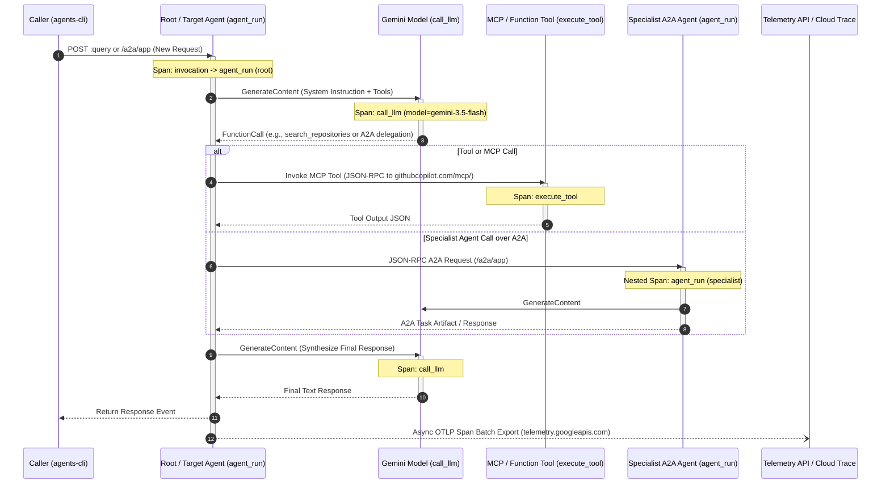
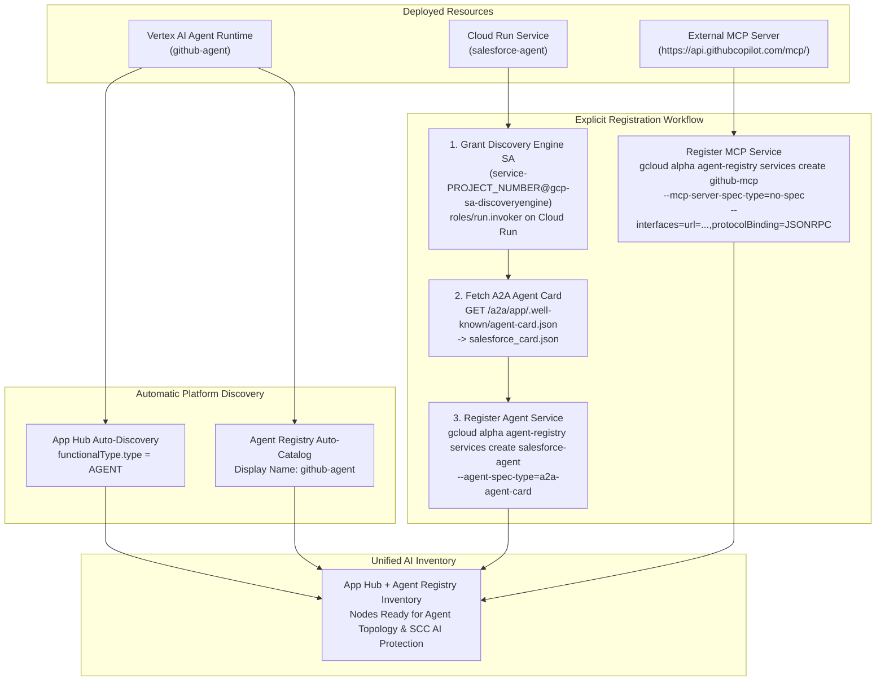
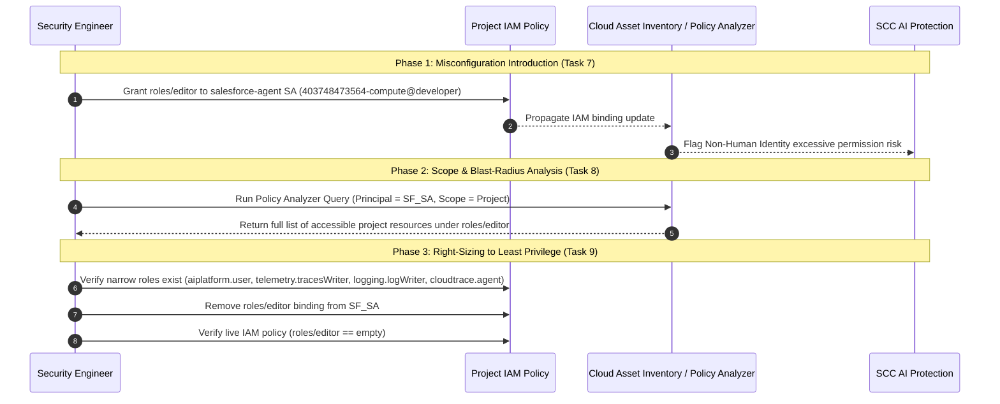

# Technical Architecture & Design Document — Observability and Security for Enterprise Agents

> **Document Purpose:** This technical design document details the architecture, control-plane discovery mechanisms, OpenTelemetry instrumentation patterns, topology graph synthesis, and Security Command Center (SCC) AI Protection governance model implemented for a multi-runtime enterprise agent fleet on Google Cloud.

---

## 1. Problem Statement & Architectural Goals

Modern enterprise AI systems rarely live on a single compute runtime or inside a single boundary. A typical production architecture combines:
- **Managed Agent Runtimes** (such as **Vertex AI Agent Runtime / Reasoning Engine**) for orchestrators and specialized agents.
- **Serverless Container Runtimes** (such as **Cloud Run**) for domain-specific A2A agents that require custom container dependencies or private VPC egress.
- **External Model Context Protocol (MCP) Servers** (such as `https://api.githubcopilot.com/mcp/`) and third-party SaaS APIs (such as Salesforce REST/SOSL APIs).

Without a unified observability and security layer, platform teams face four critical blind spots:
1. **Fragmented Request Flows:** When a user request traverses multiple agents over A2A and invokes external MCP servers, standard container logs cannot reconstruct the causal waterfall of model invocations (`call_llm`) and tool calls (`execute_tool`).
2. **Shadow AI & Incomplete Inventory:** While Vertex AI Agent Runtime resources are natively known to the AI platform, agents deployed on generic compute runtimes (Cloud Run, GKE) and external MCP endpoints look like ordinary web services unless explicitly classified and registered.
3. **Invisible Runtime Dependencies:** Static architecture diagrams drift from reality. Platform engineers need a live **Agent Topology** derived from actual runtime trace telemetry combined with verified registry metadata.
4. **Over-Privileged Non-Human Identities (NHIs):** Agents run as service accounts or workload identities. A common anti-pattern during prototyping is granting broad primitive roles (such as `roles/editor`) to an agent's service account, creating a severe blast radius if the agent is compromised via prompt injection or tool misuse.

### Architectural Goals
Both **Agent Topology** and **Security Command Center (SCC) AI Protection** consume the exact same two foundational inputs:
$$\text{Unified AI Observability \& Security} = \underbrace{\text{App Hub + Agent Registry}}_{\text{Node Discovery \& Classification}} + \underbrace{\text{OpenTelemetry Distributed Traces}}_{\text{Runtime Edges \& Activity Analysis}}$$

---

## 2. End-to-End System Architecture

### 2.1 Component & Data-Flow Architecture



---

## 3. Deep Dive: Distributed Tracing for ADK Agents

### 3.1 The Three Pillars of Agent Traceability

For an ADK agent to emit traces that populate **Cloud Trace**, **Agent Topology**, and **SCC AI Protection**, three components must be in place. If any one of the three is missing, the agent executes requests normally, but produces no usable GenAI spans and its edges in the Agent Topology graph remain empty:

| Pillar | Component | File / Location | Purpose |
| :--- | :--- | :--- | :--- |
| **1. Instrumentation Library** | `google-adk[gcp,otel-gcp]>=2.0.0,<3.0.0` & `opentelemetry-instrumentation-google-genai` | `pyproject.toml` | Hooks into the ADK runner and Google GenAI SDK to automatically generate `invocation`, `agent_run`, `call_llm`, and `execute_tool` spans with OpenTelemetry GenAI semantic conventions. |
| **2. OTLP Exporter Setup** | `setup_telemetry()` calling `get_gcp_exporters(enable_cloud_tracing=True)` | `app/app_utils/telemetry.py` & `app/fast_api_app.py` | Configures the OpenTelemetry SDK resource (`get_gcp_resource(project_id)`) and points the span exporter at Google Cloud's **Telemetry OTLP API** (`telemetry.googleapis.com`). |
| **3. Runtime Identity IAM Role** | `roles/telemetry.tracesWriter` (Cloud Telemetry Traces Writer) | Project IAM Policy | Authorizes the service account under which the agent container runs to write OTLP trace spans to `telemetry.googleapis.com`. |

### 3.2 Code-Level Telemetry Architecture (`app/app_utils/telemetry.py`)

Both `github-agent` and `salesforce-agent` initialize OpenTelemetry at FastAPI startup (`app/fast_api_app.py`) via `setup_telemetry()`:

```python
# Excerpt from agents/salesforce-agent/app/app_utils/telemetry.py
def setup_telemetry() -> str | None:
    """Configure GenAI prompt/response logging via OpenTelemetry."""
    # Keep full prompts/responses out of trace span attributes by default
    os.environ.setdefault("ADK_CAPTURE_MESSAGE_CONTENT_IN_SPANS", "false")
    ...
    # Set up OpenTelemetry exporters for Cloud Trace and Cloud Logging
    credentials, project_id = google.auth.default()
    otel_hooks = get_gcp_exporters(
        enable_cloud_tracing=True,
        enable_cloud_metrics=False,
        enable_cloud_logging=True,
        google_auth=(credentials, project_id),
    )
    otel_resource = get_gcp_resource(project_id)
    maybe_set_otel_providers(
        otel_hooks_to_setup=[otel_hooks],
        otel_resource=otel_resource,
    )

    # Set up GenAI SDK instrumentation
    _setup_instrumentation_lib_if_installed()
```

### 3.3 Span Hierarchy & Waterfall Anatomy

When a request hits an ADK agent, OpenTelemetry records a structured tree of spans within a single Trace ID:



### 3.4 Runtime Identity Comparison for Trace Export

| Runtime | Agent | Execution Identity (Principal) | Telemetry Grant Requirement |
| :--- | :--- | :--- | :--- |
| **Vertex AI Agent Runtime** | `github_agent` | `service-<PROJECT_NUMBER>@gcp-sa-aiplatform-re.iam.gserviceaccount.com` | **Managed Built-In Telemetry:** Exports automatically when `GOOGLE_CLOUD_AGENT_ENGINE_ENABLE_TELEMETRY=true` and the Reasoning Engine Service Agent has `roles/cloudtrace.agent` / `roles/logging.logWriter`. No per-agent `telemetry.tracesWriter` grant required in Task 2. |
| **Cloud Run** | `salesforce_agent` | `<PROJECT_NUMBER>-compute@developer.gserviceaccount.com` (or custom SA) | **Explicit Per-Service-Account Grant:** Because the container calls `telemetry.googleapis.com` directly using Application Default Credentials (ADC), its service account **must** be explicitly granted `roles/telemetry.tracesWriter` on the project. |

---

## 4. Deep Dive: Multi-Runtime Discovery & Inventory Architecture

Before a workload can appear as a node in **Agent Topology** or as an AI asset in **SCC AI Protection**, Google Cloud must know:
1. **That the resource exists** (Inventory), and
2. **That it is an Agent or MCP Server** rather than a generic microservice (Classification).

Google Cloud maintains this state across two tightly integrated control-plane services:
- **App Hub (`apphub.googleapis.com`)**: Automatically discovers infrastructure workloads (`discoveredWorkloads`) across the project, classifies agent runtimes with `workloadProperties.functionalType.type = "AGENT"`, and catalogs MCP servers. **Without the App Hub API enabled, neither Agent Topology nor SCC AI Protection will display agents or MCP servers.**
- **Agent Registry (`agentregistry.googleapis.com`)**: Provides the unified registry of agents and MCP servers, storing A2A Agent Cards (`a2a-agent-card`), endpoint interfaces (`HTTP_JSON`, `JSONRPC`), and MCP tool catalogs (`no-spec` or `tool-spec`).

### 4.1 Discovery Behavior by Resource Type



### 4.2 Why Discovery Engine Needs `roles/run.invoker` on Cloud Run

When registering a private Cloud Run A2A agent (`--no-allow-unauthenticated`), the platform validates and ingests the agent's A2A card (`/.well-known/agent-card.json` or `/a2a/app/.well-known/agent-card.json`). The platform performs this introspection using the **Discovery Engine Service Agent**:
```text
service-${PROJECT_NUMBER}@gcp-sa-discoveryengine.iam.gserviceaccount.com
```
Therefore, provisioning the `discoveryengine.googleapis.com` service identity and granting it `roles/run.invoker` on the `salesforce-agent` Cloud Run service is a mandatory prerequisite before registering the agent in Agent Registry.

### 4.3 MCP Server Registration Modes (`no-spec` vs. `tool-spec`)

When registering an MCP server in Agent Registry via `gcloud alpha agent-registry services create`, two specification modes are supported:
- **`--mcp-server-spec-type=no-spec`**: Registers the MCP server's endpoint URL and transport protocol binding (`protocolBinding=JSONRPC`, `url=https://api.githubcopilot.com/mcp/`) without uploading a static `tools/list` schema. This is ideal for external third-party MCP servers (like GitHub Copilot MCP) so that Agent Topology and SCC AI Protection can match outbound trace calls to the registered MCP server node.
- **`--mcp-server-spec-type=tool-spec`** (with `--mcp-server-spec-content`): Uploads the full One MCP `tools/list` JSON schema to also catalog individual tool definitions in Agent Registry.

---

## 5. Deep Dive: Security Command Center (SCC) AI Protection & IAM Governance

### 5.1 SCC AI Protection Capabilities

Once agents and MCP servers are discovered via App Hub and Agent Registry, **Security Command Center (SCC) AI Protection** (accessible at `https://console.cloud.google.com/agent-platform/security`) provides four core security pillars:

1. **AI Asset Inventory:** Central visibility into all registered agents (across Vertex AI Agent Runtime and Cloud Run), foundational models, and MCP servers.
2. **Posture & Excessive Permissions (`Agents with excessive permissions`):** Detects Non-Human Identity (NHI) risks where an agent's backing service account possesses overly broad IAM roles (e.g., `roles/editor` or `roles/owner`).
3. **Toxic Combinations & Attack Path Simulation:** Evaluates multi-step attack graphs (approx. every 6 hours for organizations with SCC Premium/Enterprise and High-Value Resource Sets configured) to flag toxic combinations such as *"Over-privileged agent exposed to the public internet"*.
4. **Agent Platform Threat Detection (`AI threats`):** Monitors Vertex AI Agent Runtime containers in near real-time for runtime attacks—including malicious binary execution (`Execution: Added Malicious Binary Executed`), container escapes, and reverse shells—as well as control-plane threats.

### 5.2 Blast-Radius Verification & Least-Privilege Remediation Flow



### 5.3 Least-Privilege IAM Role Matrix for `salesforce-agent`

To operate securely under least privilege, the `salesforce-agent` Cloud Run service account (`403748473564-compute@developer.gserviceaccount.com`) requires **only** the following four narrow roles:

| IAM Role | Role Title | Why the Agent Needs It |
| :--- | :--- | :--- |
| `roles/aiplatform.user` | Vertex AI User | Invokes the Gemini model (`gemini-3.5-flash`) via Vertex AI (`aiplatform.googleapis.com`) and accesses Vertex AI Memory Bank if configured. |
| `roles/telemetry.tracesWriter` | Cloud Telemetry Traces Writer | Exports OpenTelemetry GenAI spans (`agent_run`, `call_llm`, `execute_tool`) via the Telemetry OTLP API (`telemetry.googleapis.com`). |
| `roles/logging.logWriter` | Logs Writer | Writes structured application and GenAI prompt/response telemetry logs to Cloud Logging (`logging.googleapis.com`). |
| `roles/cloudtrace.agent` | Cloud Trace Agent | Supports standard Cloud Trace span ingestion and legacy trace exporter compatibility (`cloudtrace.googleapis.com`). |

> **Why `IAM Recommender` vs. `Policy Analyzer`?**
> In production environments, **IAM Recommender** analyzes ~90 days of real permission usage to automatically suggest dropping `roles/editor` in favor of narrow roles. When a broad grant is newly introduced (or during an incident audit), **Policy Analyzer** (backed by Cloud Asset Inventory) provides immediate deterministic proof of every resource the service account can access, allowing engineers to verify the blast radius and right-size permissions immediately.
