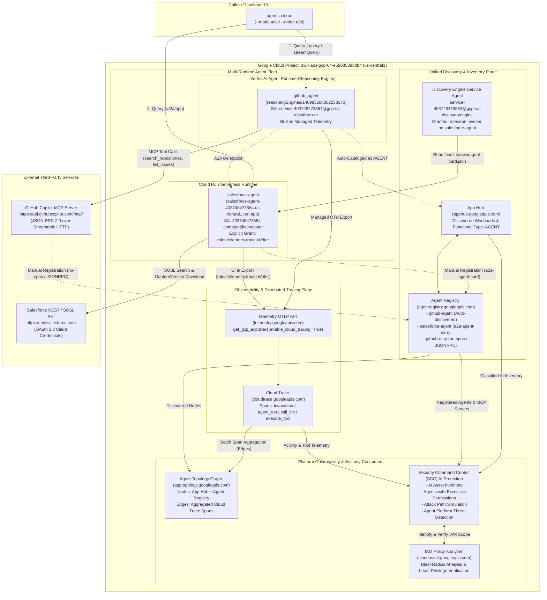

# Observability and Security for Enterprise Agents on Google Cloud — Architecture, Design & Step-by-Step Runbook

> **Documents Included in this Repository:**
> - [`ARCHITECTURE_AND_DESIGN.md`](./ARCHITECTURE_AND_DESIGN.md) — Deep-dive Technical Design Document covering OpenTelemetry Distributed Tracing for ADK Agents, Multi-Runtime Discovery (App Hub & Agent Registry), Agent Topology Graph Synthesis, Security Command Center (SCC) AI Protection, IAM Policy Analyzer, and Runtime Threat Detection.
> - [`RUNBOOK.md`](./RUNBOOK.md) — Complete Step-by-Step Execution Runbook (Tasks 1–10) with exact `gcloud`, `agents-cli`, and `curl` commands, A2A Agent Card schemas, and verified lab outputs.
> - [`AGY_SESSION_HISTORY.md`](./AGY_SESSION_HISTORY.md) — Complete chronological Antigravity (AGY) execution log, parallel deployment timeline, and command verification transcript.
> - [`agents/github-agent/`](./agents/github-agent/) — Google ADK Agent (`github_agent`) deployed to **Vertex AI Agent Runtime (Reasoning Engine)** and connected to the external GitHub MCP Server (`https://api.githubcopilot.com/mcp/`).
> - [`agents/salesforce-agent/`](./agents/salesforce-agent/) — Google ADK A2A Specialist Agent (`salesforce_agent`) deployed to **Cloud Run**, instrumented with OpenTelemetry (`google-adk[gcp,otel-gcp]`).
> - [`salesforce_card.json`](./salesforce_card.json) — Downloaded A2A Agent Card (`/.well-known/agent-card.json`) registered in Google Cloud Agent Registry.
> - [`apex_labs/lab2_prereqs.sh`](./apex_labs/lab2_prereqs.sh) — Baseline multi-runtime agent fleet provisioning script.

---

## 1. Executive Summary & Lab Scenario

In the **Build Enterprise Agents** lab, you deployed a multi-agent system spanning two different serverless runtimes:
- **`github_agent` on Vertex AI Agent Runtime (Reasoning Engine)**: Reaches out to an external **GitHub MCP Server** (`https://api.githubcopilot.com/mcp/`) for repository and issue tools and communicates over the **Agent2Agent (A2A)** protocol.
- **`salesforce_agent` on Cloud Run**: Searches an organization's Salesforce Files document library via the Salesforce REST/SOSL API (2LO Client Credentials) and serves an A2A-compliant endpoint (`/a2a/app`).

While that multi-agent system can run, platform operators cannot yet **observe it end-to-end** or **reason about its security posture**. In this lab, we add the **Observability and Security Layer**:
1. **Distributed Tracing (OpenTelemetry & Cloud Trace)**: Verify that each agent is instrumented with `google-adk[gcp,otel-gcp]` (`opentelemetry-instrumentation-google-genai`) and exports GenAI spans (`agent_run`, `call_llm`, `execute_tool`) via `setup_telemetry()` (`get_gcp_exporters(enable_cloud_tracing=True)`) to the Telemetry OTLP API (`telemetry.googleapis.com`), and grant `roles/telemetry.tracesWriter` to the Cloud Run runtime service account.
2. **Unified Multi-Runtime Discovery (App Hub & Agent Registry)**:
   - Confirm auto-discovery of Vertex AI Agent Runtime workloads (`github-agent`) as `functionalType.type = AGENT` in **App Hub** (`apphub.googleapis.com`) and **Agent Registry** (`agentregistry.googleapis.com`).
   - Grant the **Discovery Engine Service Agent** (`service-<PROJECT_NUMBER>@gcp-sa-discoveryengine.iam.gserviceaccount.com`) `roles/run.invoker` on `salesforce-agent`, fetch its A2A Agent Card (`/a2a/app/.well-known/agent-card.json`), and manually register it in **Agent Registry** (`--agent-spec-type=a2a-agent-card`).
   - Register the external **GitHub MCP Server** (`github-mcp`) in **Agent Registry** (`--mcp-server-spec-type=no-spec`, `protocolBinding=JSONRPC`).
3. **End-to-End Agent Topology Visualization**: Combine inventory discovery (nodes from App Hub and Agent Registry) with batch-aggregated distributed trace spans (edges from Cloud Trace) to render the multi-runtime system as a single **Agent Topology Graph**.
4. **AI Security Posture Management & Least-Privilege Remediation (SCC AI Protection & Policy Analyzer)**:
   - Inspect the discovered AI asset inventory, excessive permissions, and runtime threats in **Security Command Center (SCC) AI Protection**.
   - Simulate a real-world over-privilege misconfiguration by granting `roles/editor` to the `salesforce-agent` service account, prove its blast radius across project resources using **Cloud Asset Inventory Policy Analyzer**, and remediate the service account back to strict least privilege (`roles/aiplatform.user`, `roles/telemetry.tracesWriter`, `roles/logging.logWriter`, `roles/cloudtrace.agent`).

---

## 2. High-Level System Architecture



---

## 3. Summary of Tasks & Verified Objectives

| Task | Objective | Key Resource / Command | Status |
| :--- | :--- | :--- | :---: |
| **Task 1** | Prepare environment, deploy fleet & enable observability/discovery APIs | `observability`, `cloudtrace`, `telemetry`, `apphub`, `apptopology`, `agentregistry`, `cloudasset`, `monitoring`, `logging` | ✅ Verified |
| **Task 2** | Verify OpenTelemetry setup, grant `roles/telemetry.tracesWriter`, and emit traces | `roles/telemetry.tracesWriter` on `403748473564-compute@developer.gserviceaccount.com` + `agents-cli run` | ✅ Verified |
| **Task 3** | Confirm Agent Runtime auto-discovery in Agent Registry & App Hub | `gcloud alpha agent-registry agents list` & `apphub.googleapis.com/v1/.../discoveredWorkloads` | ✅ Verified |
| **Task 4.1** | Grant Discovery Engine service agent Cloud Run Invoker access | `roles/run.invoker` to `service-403748473564@gcp-sa-discoveryengine.iam.gserviceaccount.com` | ✅ Verified |
| **Task 4.2** | Register Cloud Run agent (`salesforce-agent`) in Agent Registry | `gcloud alpha agent-registry services create salesforce-agent --agent-spec-type=a2a-agent-card` | ✅ Verified |
| **Task 5** | Register GitHub MCP server (`github-mcp`) in Agent Registry | `gcloud alpha agent-registry services create github-mcp --mcp-server-spec-type=no-spec` | ✅ Verified |
| **Task 6** | View unified multi-runtime graph in Agent Topology | Console: **Agent Platform > Agent Registry > Agents > Topology** | ✅ Verified |
| **Task 7** | Inspect SCC AI Protection & simulate excessive permission risk | Grant `roles/editor` to `salesforce-agent` service account | ✅ Verified |
| **Task 8** | Prove blast radius of over-privileged agent using Policy Analyzer | Console: **IAM & Admin > Policy Analyzer** query on `SF_SA` | ✅ Verified |
| **Task 9** | Remediate over-privileged agent & verify least privilege | Remove `roles/editor`, retain 4 narrow roles (`aiplatform.user`, `telemetry.tracesWriter`, `logging.logWriter`, `cloudtrace.agent`) | ✅ Verified |
| **Task 10** | *(Optional)* Trigger and view runtime attacks with Agent Platform Threat Detection | Simulated EICAR execution detector (`Execution: Added Malicious Binary Executed`) | ✅ Documented |

---

## 4. Repository Structure

```text
.
├── README.md                          # Executive Overview, Architecture Diagram & Summary Table
├── ARCHITECTURE_AND_DESIGN.md         # Comprehensive Technical Design Document (Tracing, Discovery, Topology, SCC)
├── RUNBOOK.md                         # Step-by-Step Execution Runbook with Verified Lab Commands & Outputs
├── AGY_SESSION_HISTORY.md             # Chronological Antigravity (AGY) Agent Execution Log & Transcript
├── salesforce_card.json               # Downloaded A2A Agent Card from salesforce-agent on Cloud Run
├── apex_labs/
│   └── lab2_prereqs.sh                # Prerequisite script to deploy github-agent and salesforce-agent
└── agents/
    ├── github-agent/                  # Agent Runtime ADK Agent (GitHub MCP Toolset + A2A Server)
    │   ├── Dockerfile
    │   ├── agents-cli-manifest.yaml
    │   ├── pyproject.toml
    │   └── app/
    │       ├── agent.py
    │       ├── fast_api_app.py
    │       └── app_utils/
    │           ├── a2a.py
    │           ├── reasoning_engine_adapter.py
    │           ├── services.py
    │           ├── telemetry.py
    │           └── typing.py
    └── salesforce-agent/              # Cloud Run ADK Agent (Salesforce REST/SOSL Tool + A2A Server)
        ├── Dockerfile
        ├── agents-cli-manifest.yaml
        ├── pyproject.toml
        └── app/
            ├── agent.py
            ├── fast_api_app.py
            ├── salesforce_client.py
            ├── tools.py
            └── app_utils/
                ├── a2a.py
                ├── reasoning_engine_adapter.py
                ├── services.py
                ├── telemetry.py
                └── typing.py
```
